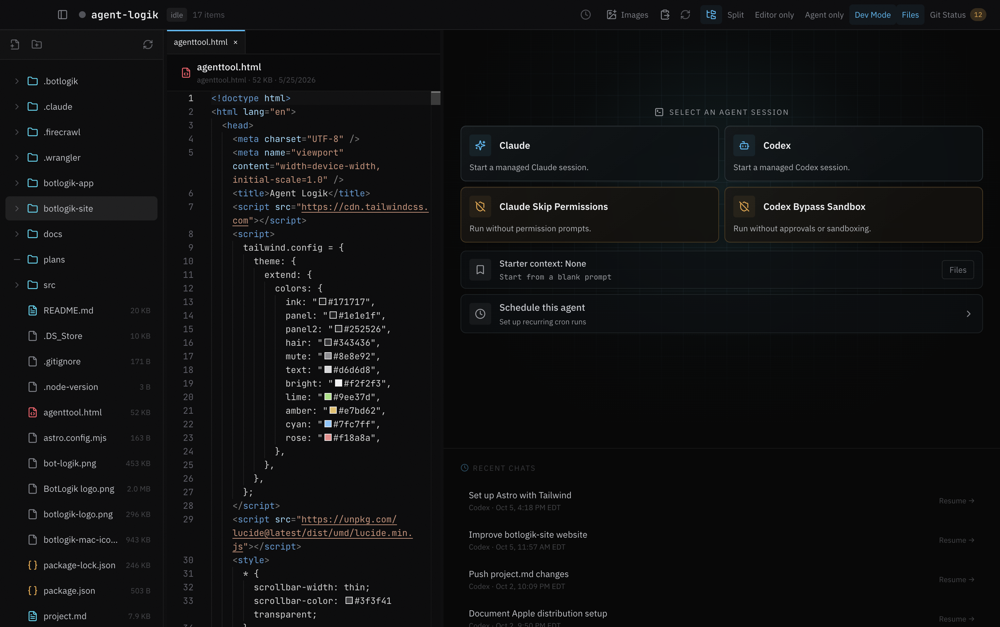

# BotLogik

BotLogik is a lightweight macOS workspace for building apps and AI agents with Claude Code, Codex, and OpenRouter. It combines real terminals, project files, a focused editor, and read-only Git diffs in one window.

Current application version: **1.1.0**. This repository contains the standalone desktop application.



## Requirements

- An Apple silicon Mac. Other platforms and Intel packaging are not validated.
- Node.js 22 and npm (see `.node-version`).
- Git. Xcode Command Line Tools may be needed if native dependencies require compilation.
- For terminal agents, install and authenticate Claude Code (`claude`) and/or Codex (`codex`) separately. They must be on your shell's PATH.
- For OpenRouter, supply your own API key in Settings; no key is needed to build or run tests.

## Get started

```bash
git clone https://github.com/cbanhan/BotLogik-App-OS.git
cd BotLogik-App-OS
npm ci
npm run dev
```

Connect a disposable project folder first, then choose your agent provider. BotLogik uses your locally installed CLI tools and their authentication. The development command clears `ELECTRON_RUN_AS_NODE` to allow normal Electron startup.

## Commands

| Command | Purpose |
| --- | --- |
| `npm run dev` | Start the app in development mode |
| `npm test` | Run Node regression tests |
| `npm run build` | Compile Electron main, preload, and renderer code |
| `npm run test:workspace` | Build and run an isolated Electron workspace smoke test |
| `npm run test:openrouter` | Build and run an isolated OpenRouter UI smoke test with network requests blocked |
| `npm run dist` | Build unsigned Apple silicon community DMG and ZIP artifacts |

Packaging outputs go to `dist/`. Community packages use the **BotLogik Community** name and `com.botlogik.community` app identity. They are unsigned and not notarized, so macOS may block opening downloaded copies. Running from source with `npm run dev` is the supported starting point for running your own fork. Signing credentials are not needed. Community builds have automatic updates disabled and never contact the official update feed.

## Features and permissions

- Workspace discovery, favorites, terminal sessions, and resumable provider conversations.
- **Open Terminal**, beneath OpenRouter on the launch screen, opens an interactive shell inside BotLogik in the selected workspace folder. Each new session starts fresh without Apple Terminal session restoration; your normal shell configuration and command history still apply. Use **End Session** to return to the launch choices.
- File explorer, constrained text editor, image references, and Git status/diffs. Markdown, `.gitignore`, and other supported text files can be opened, edited, saved, and created up to 50 MB (previously 100 KB). Files above that limit show an explicit message; contents are never silently truncated.
- Scheduled Claude/Codex runs and run history.
- OpenRouter chat with file mentions, tool approvals, and local conversation history.

**Scheduled runs bypass CLI permission prompts and run unattended with your user permissions.** Only schedule work in trusted workspaces. Manual CLI permissions are controlled by the provider. OpenRouter file writes and shell commands require approval, but approved commands are not sandboxed.

Configuration is stored in `~/.agent-logik/`. OpenRouter keys use Electron safeStorage encryption; conversation files contain plaintext messages and tool output. Development and community builds still share this application-managed configuration location with official builds. Use disposable workspaces for testing and back up existing configuration before experimenting. Provider requests may send prompts, referenced files, and tool results to the selected provider. See [OpenRouter details](docs/openrouter.md).

## Source layout

- `src/main/`: Electron main process, workspace services, PTY sessions, scheduling, updates, and OpenRouter tools.
- `src/main/preload.js`: constrained renderer IPC bridge.
- `src/renderer/`: application UI, styles, editor, and chat components.
- `src/shared/`: shared parsing and validation helpers.
- `tests/`: regression tests and isolated Electron smoke tests.
- `scripts/`: local build helpers; `assets/icon-source.png` is the macOS icon source.

External contributions and pull requests are not accepted. To customize the app, fork it and maintain your own instance. See [CONTRIBUTING.md](CONTRIBUTING.md) for the policy and [AGENTS.md](AGENTS.md) for development context. Vulnerability reporting guidance is in [SECURITY.md](SECURITY.md).

## License

Project source is provided under the [MIT License](LICENSE). Dependencies retain their own licenses. The license does not grant trademark rights in the BotLogik name or logo; identify modified distributions clearly and do not imply official endorsement.

## Troubleshooting provider errors

Failed Claude/Codex launches, unexpected terminal exits, and OpenRouter failures appear in a persistent error panel. Expand **Technical details**, use **Copy details**, or dismiss the panel and reopen **Recent errors**. For exited terminal sessions, **View current terminal output** reveals the terminal behind the launch choices. This is the current terminal buffer, not an archived transcript.

BotLogik keeps the latest 50 structured error summaries locally across restarts, scoped to each workspace. Use **Clear workspace error history** to remove them. Raw error messages remain in memory only; diagnostic history does not save terminal output, prompts, API keys, or environment variables. Review details before sharing them: live messages can contain local paths. Existing provider conversation storage is separate.

CLI discovery checks executable files on BotLogik’s PATH, including `~/.local/bin`, Homebrew, and npm-global directories. If a tool works in Terminal but cannot be found in BotLogik, run `command -v claude` or `command -v codex` to check its location. Shell aliases and custom shell-only PATH setup are not imported automatically. Errors never trigger automatic retries.

## AI tool traces

Open **Tools** in the workspace header to inspect a drawer below the conversation. Choose a recorded conversation, filter to failed calls, expand inputs/results, copy details, or clear that conversation’s traces. The error panel’s **View failed tools** action opens this filter. Tracing is observational: approvals remain in the provider’s normal interface, and traces never execute or retry tools.

Claude/Codex use the existing version-gated activity hooks; they must be enabled/trusted by the CLI. The drawer reports unavailable/waiting status when no events arrive. Only top-level calls reported by those hooks are captured; delegated agents’ internal actions and older conversations are not backfilled. OpenRouter records calls directly as they execute. Regular shells do not generate AI traces. Results or durations not supplied/observed are not invented; unfinished calls become **Unknown** after interruption or restart.

Traces are stored locally in `~/.agent-logik/tool-traces.json`, associated with the workspace, provider, and conversation. Retention is bounded to 50 conversations, 200 calls per conversation, and 1,000 calls overall, with entries older than 30 days removed during trace processing. Each input/result is limited to about 2,000 characters. User prompt events and private reasoning are not stored. Known credential fields/patterns are redacted, but tool arguments/results can still contain sensitive file content or local paths; review before copying. Trace history is separate from the provider’s saved chat history.

## Reduce tool clutter — current limitations

**Settings → Reduce tool clutter** is off by default. OpenRouter applies changes immediately: routine tool arguments/results become compact activity summaries such as **Working…**, **Reading files…**, or **Running commands…**, with a **View tools** link. Approval requests, failed/declined tools, interrupted results, assistant explanations, and code examples remain visible. This is a display preference; tool execution, permissions, and saved messages do not change.

New or resumed interactive Claude Code sessions use Claude’s native fullscreen **Focus** view when the installed CLI is 2.1.311 or newer (BotLogik’s conservative compatibility baseline). Focus summarizes all tool activity, not only Bash, and Claude controls its wording and layout. Existing sessions and unattended scheduled runs are unaffected. Older or unverified CLI versions keep their normal view and show a notice. User-managed accessibility settings or provider policy may also affect the native renderer. BotLogik supplies launch-only settings; it does not rewrite global Claude preferences.

**Known limitation: Codex is not supported yet.** Its existing terminal display and regular shell sessions remain unchanged. Reliable command-only hiding would require a verified native Codex display option or a separate structured chat integration; filtering terminal output is not used. Captured tool details remain available in **Tools**, subject to the trace retention and size limits above.

## Project models and reasoning

Open **Models** in the chat header before launching Claude or Codex. Choose a provider, model, and supported reasoning level, then **Use for next chat**. Check **Save as this project’s default** to remember the choice across app restarts. Each project has independent Claude and Codex defaults, stored by canonical workspace path in BotLogik configuration. Choose **Provider default** to remove explicit overrides. Launches use session-only CLI flags; global CLI configuration is not rewritten. Resuming a conversation leaves its settings with the provider. Scheduled runs retain their separate configuration.

During a chat, the header’s **Model & effort** control prepares a slash command without submitting it. First confirm the terminal is at an empty prompt; drafts, menus, and approvals must be handled in the terminal. BotLogik blocks preparation while observed activity is working or waiting for approval/input, and rejects stale session requests. Press Enter yourself and verify the provider’s response. Codex receives `/model <model> --reasoning=<level>` when explicit values are selected. Provider-default effort adds no override; use the native picker to inspect or reset the current effort. Claude uses separate `/model` and `/effort` pickers: choose there and press **s** for this session only. The popover’s model/effort dropdowns configure launch defaults; they do not automate Claude’s native picker.

**Current limits:** activity hooks cannot prove a terminal has an empty prompt or report confirmed model/effort changes. The header therefore identifies the provider and selector, rather than presenting a requested value as verified active state. No command is automatically submitted and no pending change is reported as applied. Claude session-only effort selection requires a compatible CLI (2.1.257+); use launch defaults on older versions. Codex slash-command support depends on the installed CLI; provider errors remain visible in its terminal. Claude choices come from installed-CLI discovery and Codex choices from its local model cache; missing/removed saved models must be replaced before launching with an explicit override. Saving project defaults is independent of preparing a live switch and may succeed even if that switch is subsequently blocked.
